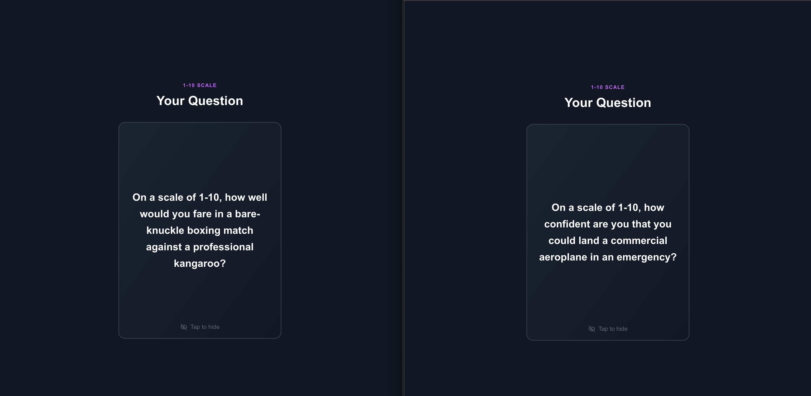
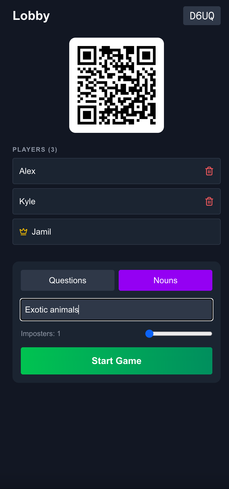
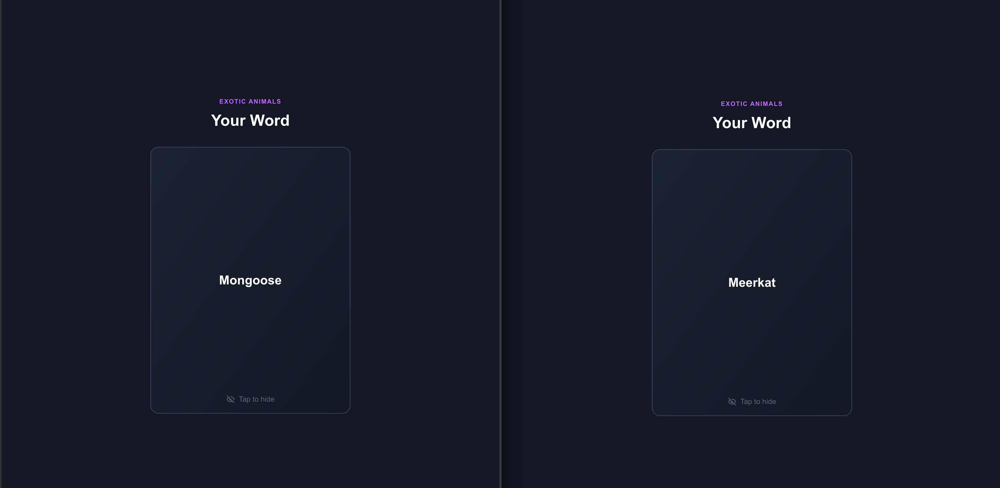

# Impostr

A Spyfall-style party game you play on your phones. Everyone gets the same question or noun except the imposter, who gets a different one with a similar kind of answer. Nobody knows which one they've got, so you all answer out loud and try to work out whose answer doesn't fit.

**Live:** https://impostr-weld.vercel.app/

## Screenshots



<p>
  
  
</p>

## How it works

1. One person hosts and gets a room code and QR code. Everyone else scans it or types the code in. You need at least 3 players.
2. The host picks a mode, an optional topic (e.g. "football" or "90s films") and how many imposters there are.
3. When the host starts the round, Gemini writes a pair of prompts. Tap your card to see yours privately.
4. Go round and answer. The host then reveals the common prompt to everyone.
5. Discuss, vote for who you think the imposter is, and the host reveals the truth.

There are two modes:

- **Questions** (default): the two questions are about unrelated things but share an answer format, like a count, a price, a rating out of 10 or a percentage. "How many days could you survive in the wild?" vs "How many hours of sleep do you need?"
- **Nouns**: closer to classic Spyfall. Most people get a word and the imposter gets a related one, like Coffee and Tea.

## Running it locally

You'll need Node.js, a [Gemini API key](https://aistudio.google.com/apikey) and a Firebase project with:

- a Realtime Database created in locked mode, with the rules from `database.rules.json` deployed (`npx firebase-tools deploy --only database`)
- Anonymous sign-in enabled under Authentication
- a web app registered, for the client config
- a service account key, for the API routes
- App Check set up with reCAPTCHA Enterprise

Copy `.env.example` to `.env.local` and paste in your values:

| Variable | What it is |
|----------|------------|
| `GEMINI_API_KEY` | From Google AI Studio |
| `GEMINI_MODEL` | Optional, defaults to `gemini-3.5-flash-lite`. Change it here if the model gets retired |
| `NEXT_PUBLIC_FIREBASE_*` | From the web app config. The database URL is at the top of the Realtime Database page |
| `NEXT_PUBLIC_RECAPTCHA_SITE_KEY` | The reCAPTCHA key you registered with App Check |
| `NEXT_PUBLIC_APP_CHECK_DEBUG_TOKEN` | Optional, local only. A debug token so App Check lets localhost through |
| `FIREBASE_CLIENT_EMAIL` | `client_email` from the service account key |
| `FIREBASE_PRIVATE_KEY` | `private_key` from the service account key, in quotes |
| `CRON_SECRET` | Any random string. Protects the daily cleanup job in `vercel.json` that deletes old rooms |

Then:

```bash
npm install
npm run dev
```

App Check makes sure requests to the database and the prompt generator come from the real site and not a script using the public Firebase config. `/api/generate` always checks App Check and asks for a single-use token each round, so a captured token can't be replayed.
